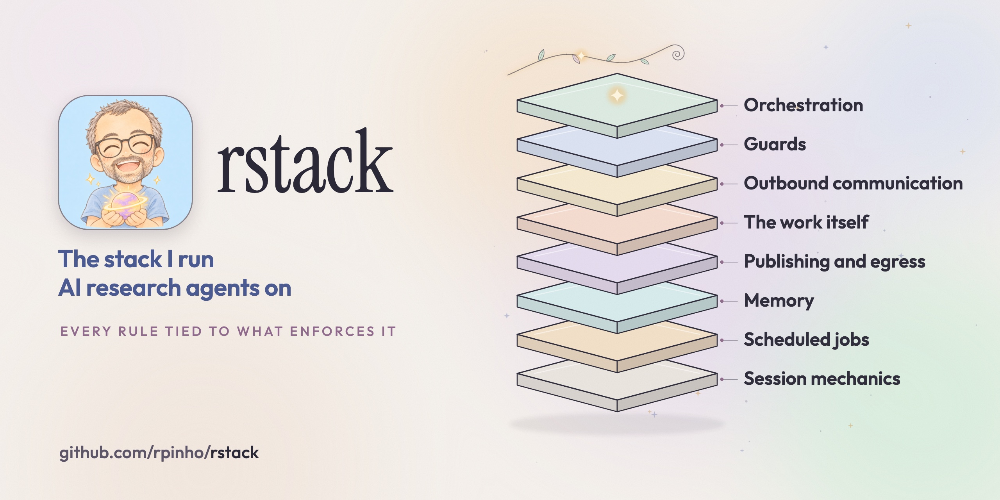
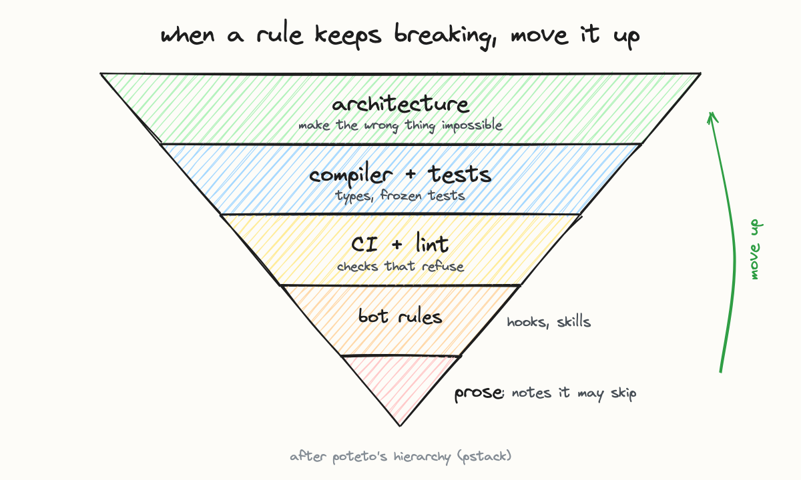

# rstack

rstack is the harness I run research agents on. One agent searches, and a separate one referees. This is how it works, what it found, and what still doesn't work. Every number has a source at the end. No journal has accepted any of this, so all of it is a candidate.

## The problem

Agents do a lot of stuff. The hard part is to know if you can trust it.

You will not trust the AI from day one, so you have to start small. At first it does stuff bad, and then it starts doing stuff better, and your trust meter goes up. But that only works if something checks the work, and it can't be the same agent.

And the problem is not that it does nothing. It's that it does a lot, and everything looks fine. One line of work here ran about 38 workers for two days and wrote 528 claims. The reviewer passed 98% of them. None of it was any good, and every check we had was green. So the question is not if it did the work. It's if someone else can check it, and if they can say no.

## How it works

It has a yes or no gate for a lot of stuff that I do. There are five parts, and they are all in this repo.

### 1. One agent searches, a different one checks

This is the bug hunt. One agent finds bugs and writes them up as claims. The referee gets the claims and clones the code at the same commit. It reads the code, but it does not get the scripts, outputs or reasoning of the agent that found it. It writes its own input and works out the right answer by itself. Then it gives each claim a verdict, like CONFIRMED or REFUTED. A bug email that points at a verdict fails the lint until that verdict is accepted. https://github.com/rpinho/rstack/blob/main/harness/templates/bug_referee.md

The referee has to be a different model family than the hunter. If it's the same family, nothing in the verdict counts. The family comes from the launcher's receipt, because on 11-09 a Gemini referee said it was GPT. If there's no receipt, the harness uses what the referee says about itself and flags it. Batches from before we kept the hunter's family aren't checked, and get a flag too. https://github.com/rpinho/rstack/blob/main/docs/outreach.md

### 2. Planted false claims

A different family is not enough by itself. It can still say yes to everything. So in the bug hunt, every batch has at least one fake claim in with the real ones. It's a real claim with the observed and expected values swapped, or with the cause in the wrong place. The referee doesn't know which one it is. A verdict with no fake claim in its batch is refused. If it says yes to the fake one, nothing in the verdict counts. The harness counts how many each referee caught. The fakes are made from the real claims, so a careful referee can sometimes tell which one it is. They catch a referee that says yes without running anything.

Same thing for exact checkers. A checker has to say no to broken certificates before we trust it.

### 3. Guards with tests, by poteto's hierarchy

A rule that is only written down is as good as the agent that reads it. The same rule as a hook, a lint or a test works the same way every time.

The order is poteto's hierarchy, from Lauren Tan's pstack: architecture > compiler and tests > CI and lint > bot rules > prose. Architecture makes the wrong thing impossible. Prose is just a note, and the agent might not read it. When something breaks, we move it up one. https://github.com/rpinho/rstack/blob/main/rstack/principles/architecture-not-prose.md

Every guard here has a test that shows it says no when it should. And a guard has to say no, not crash. If it crashes, most hooks just let it go through. We looked at 12 of my guards, and 5 did exactly that. Now we test for that too. https://github.com/rpinho/rstack/blob/main/rstack/principles/a-guard-must-refuse-not-crash.md

### 4. The egress gate

Agents make public stuff on the same machine as my private stuff. `egress-gate` scans a folder, a text or a push, and says no if it sees a secret or a word on your list. On my machines it runs as a global git pre-push hook. You have to install the hook yourself, and anything that doesn't go through git has to be scanned by hand. Work that goes public runs in `clean-room`, with an empty identity. https://github.com/rpinho/rstack/blob/main/rstack/tools/README.md

### 5. The Codex spend wrapper

On 11-17 a Python loop called Codex 1,568 times, and the launcher never saw it. Now `codex` on the PATH is a wrapper that counts every call it sees. By default it stops a lane at 60 calls an hour, or 3 points of the weekly allowance in a day. It's not a wall. A call to the real binary by its full path, `npx`, or another machine goes around it, and one long run can go over the limit before the next call is checked. A scheduled job looks for the runs it missed. https://github.com/rpinho/rstack/blob/main/rstack/tools/codex-spend.md

## What it found

### Merged PRs

I opened 129 PRs on other people's repos, and 15 are merged. 106 are still open and 8 were closed. That's from a snapshot on November 18, 2026, with the query in it: https://github.com/rpinho/rstack/blob/main/docs/snapshots/2026-11-18-prs.md The 6 in Tao's table are bounds, and the other 9 are bug fixes.

| | Merged |
|---|---|
| Tao's optimization constants | https://github.com/teorth/optimizationproblems/pull/227, https://github.com/teorth/optimizationproblems/pull/229, https://github.com/teorth/optimizationproblems/pull/239, https://github.com/teorth/optimizationproblems/pull/251, https://github.com/teorth/optimizationproblems/pull/258, https://github.com/teorth/optimizationproblems/pull/259 |
| labbench2 | https://github.com/EdisonScientific/labbench2/pull/45, https://github.com/EdisonScientific/labbench2/pull/46, https://github.com/EdisonScientific/labbench2/pull/48, https://github.com/EdisonScientific/labbench2/pull/49 |
| pyglmnet | https://github.com/glm-tools/pyglmnet/pull/399, https://github.com/glm-tools/pyglmnet/pull/401 |
| Biomni | https://github.com/snap-stanford/Biomni/pull/372, https://github.com/snap-stanford/Biomni/pull/373 |
| agentic-pymol | https://github.com/Arcadia-Science/agentic-pymol/pull/18 |

### Planted claims

Evals are built in: exact checkers must reject corrupted certificates, and cross-family referees get planted false claims. The math checkers had to say no to 4 broken certificates for C86 and 18 for C68. https://github.com/rpinho/rstack/blob/main/harness/README.md

The plants caught something real. On 11-09 the GPT referees said yes to fake claims. They found the real bug and said yes to the fake one anyway. The fix was one line: judge the claim as it is written. https://github.com/rpinho/rstack/commit/ee2c52c

A catch is not the whole story. A referee can catch every fake one and still say yes to every real claim. That doesn't mean it would say no to a real one that's wrong. The harness warns about it, but it's only a warning.

### RNAAS

We sent four reports based on NASA TESS data to Research Notes of the American Astronomical Society (RNAAS). All four were corrected after the numbers were re-audited, and the corrected versions are on Zenodo: https://doi.org/10.5281/zenodo.23895484, https://doi.org/10.5281/zenodo.23824790, https://doi.org/10.5281/zenodo.23836131, https://doi.org/10.5281/zenodo.23895440. The corrections credit two earlier public sources for some of the signals. https://github.com/rpinho/rstack/blob/main/harness/README.md

### MecCog

For MecCog, a pipeline finds the papers on an APOE4 hypothesis and gets each finding out. A second model checks every row. No person checked them.

| | Pass | Fix | Reject | Papers | Rows |
|---|---:|---:|---:|---:|---:|
| H1 | 51 | 68 | 98 | 8 | 20 |
| H2 | 48 | 64 | 517 | 13 | 72 |
| H3 | 40 | 59 | 163 | 21 | 61 |

H2 is the first round. Claude checked 5 rows, and all 5 matched. It also found 2 bad rows, and the code catches those now. All of this is from the pipeline's README at its November 18 commit: https://github.com/rpinho/meccog-literature-pipeline/blob/2ffa2ab105e7df6d51ce07008c9bb8e270de37f8/README.md

## What still doesn't work

Most of the rules are still prose. From the README: "131 of the 356 rules have something enforcing them; 225 are still prose." I think that's fine. We only add a guard after something actually broke.

The harness can't tell if anyone was honest. From its README: "It is not an access-control sandbox, a competition platform or an independent judge of scientific truth."

The referees are models too. No human expert has refereed any of this.

## References

- Lauren Tan (@poteto), pstack: https://github.com/cursor/plugins/tree/main/pstack. rstack is named after it.
- Lilian Weng, Harness Engineering for Self-Improvement, 2026: https://lilianweng.github.io/posts/2026-07-04-harness/
- Cynthia Dwork, Vitaly Feldman, Moritz Hardt, Toniann Pitassi, Omer Reingold, Aaron Roth, Generalization in Adaptive Data Analysis and Holdout Reuse, 2015: https://arxiv.org/abs/1506.02629
- Avrim Blum, Moritz Hardt, The Ladder: A Reliable Leaderboard for Machine Learning Competitions, 2015: https://arxiv.org/abs/1502.04585
- Google DeepMind, AlphaEvolve, 2025: https://arxiv.org/abs/2506.13131

## Sources

| Numbers | Source |
|---|---|
| 38, 2, 528, 98% | https://github.com/rpinho/rstack/blob/main/rstack/principles/results-not-activity.md |
| 11-09 | https://github.com/rpinho/rstack/blob/main/docs/outreach.md |
| 12, 5 | https://github.com/rpinho/rstack/blob/main/rstack/principles/a-guard-must-refuse-not-crash.md |
| 1,568, 60, 3 | https://github.com/rpinho/rstack/blob/main/rstack/tools/codex-spend.md |
| 129, 15, 106, 8, and the PR list | https://github.com/rpinho/rstack/blob/main/docs/snapshots/2026-11-18-prs.md |
| 4, 18 | https://github.com/rpinho/rstack/blob/main/harness/README.md |
| 11-09 fix | https://github.com/rpinho/rstack/commit/ee2c52c |
| 4 reports, 4 Zenodo versions, 2 earlier reports | https://github.com/rpinho/rstack/blob/main/harness/README.md |
| H1, H2, H3, 5, 2 | https://github.com/rpinho/meccog-literature-pipeline/blob/2ffa2ab105e7df6d51ce07008c9bb8e270de37f8/README.md |
| 131, 356, 225 | https://github.com/rpinho/rstack/blob/main/README.md (November 13) |
