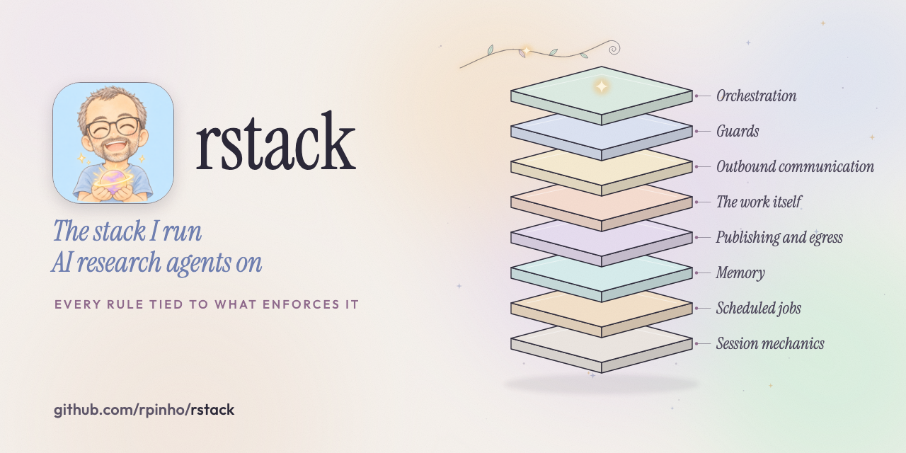
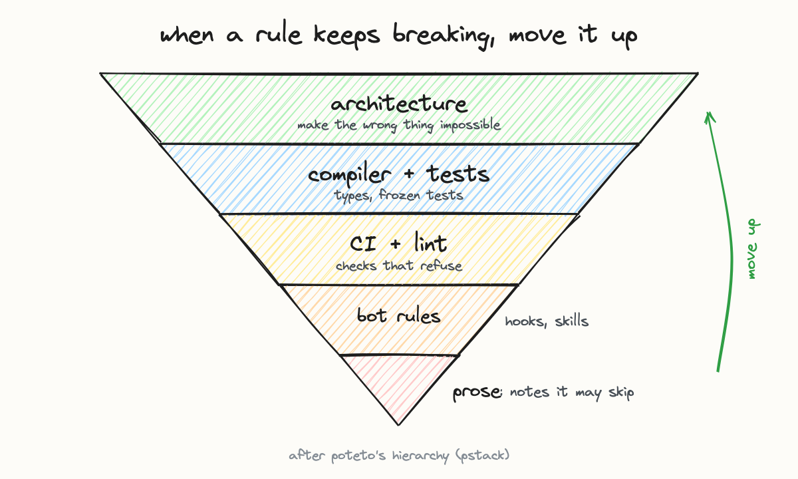

# rstack

**The stack I run AI research agents on: the map, the principles, and the machinery, in one place.**

**New to coding agents?** Most of this repo is more than you need. Clone it, run `claude` in it, and
type `/onboard`. It asks whether you're a beginner, intermediate or advanced, checks that with three
questions, and walks you through the part that fits: [beginner](docs/onboarding/beginner.md),
[intermediate](docs/onboarding/intermediate.md), [advanced](docs/onboarding/advanced.md).

Agents that do real work accumulate machinery. Guards, schedulers, linters, memory, publishing
steps. The failure mode is not ignorance; it is changing the wrong part of the
system: adding a note when what was needed was an automatic check, editing an installed copy when
the source is a repository, writing a rule in prose when the same sentence could be a program that
refuses. rstack says which layer is responsible for a problem, and keeps an honest account of which
rules have something enforcing them and which are still only prose.

It has produced real results, and the short list is near the bottom.

Named after, and owed to, **pstack**, which is where the idea of a single stack-wide entry point
came from.

## The layers, and what lives here

| Layer | What it owns |
|---|---|
| Orchestration | one conductor, many workers; a wake is a deliberate decision, not a side effect |
| Guards | a guard refuses rather than crashes, and ships with the test that proves it |
| Outbound communication | linted before it leaves, approved as the exact bytes that will be sent |
| The work itself | frozen tests, independent scoring, a yield check, baselines you can run |
| Publishing and egress | nothing leaves unscanned; an agent whose output leaves has an empty identity |
| Memory | a worktree per session, then land; one fact per file, with an index |
| Scheduled jobs | wait on an event instead of polling; heavy compute goes elsewhere |
| Session mechanics | context limits and written handoffs instead of silent compaction |

Three parts of that live in this repository. Until recently they were three repositories.

- **[`harness/`](harness/README.md)**: bounded agents on open research problems. It lets you fix
  the test and the pass mark before the first result, keep final scoring away from the agent doing the searching,
  make reviewers answer a set list of questions with evidence, stop a line of work that spends
  without finding anything, and require a published result to be reproduced by a command before it
  counts as a baseline. Several checks are opt-in and the isolation is yours to supply, not the
  harness's to create; [its Limits section](harness/README.md#limits) says which.
- **[`kb/`](kb/README.md)**: a file-based knowledge base an agent maintains over years. Each session
  works in its own copy of the repository and merges when it is done, so two agents never fight over
  the same file. The memory is the filesystem, not a context window.
- **[`SKILL.md`](SKILL.md)** and **[`rstack/`](rstack/)**: the map itself. The layer manifest, the
  principles, and two scripts: `inventory.py` lists what exists, and `coverage.py` checks the map
  and the enforcement claims in it.
- **[`rstack/hooks/`](rstack/hooks/README.md)** and **[`rstack/tools/`](rstack/tools/README.md)**:
  the guards and tools themselves, made generic. Seven hooks that refuse rather than crash, an
  event waiter that replaces polling, a relay that wakes the conductor only for decisions, an
  egress scan, a clean-identity runner and a lint for the files every session rereads. Each ships
  with the test that proves it refuses what it should. None ships a term list; you supply yours.

**[`rstack/STACK.md`](rstack/STACK.md) is the system they came from**, counted on 7 November 2026:
449 items across 16 hooks, 77 launch agents, 23 lints, 16 skills and 309 memory rules, every one
mapped to a layer. 111 of the 317 rules have something enforcing them; 206 are still prose, and
the page lists the ones broken most. It also goes through the main hooks and scheduled jobs with the
failure that made each necessary.



When a rule keeps breaking, it moves up a rung, after poteto's hierarchy. See
[architecture, not prose](rstack/principles/architecture-not-prose.md).

## Using it

Point a coding agent at [`SKILL.md`](SKILL.md); that is the entry point and it explains how to route
a task to a layer. Then build a map of your own setup. The manifest shipped here is an example with
invented data, because a real manifest names your jobs, your notes and your rules, which is not a
list anyone should publish.

```sh
python3 rstack/coverage.py  --config rstack/layers.example.json   # see it work on the example
cp rstack/layers.example.json layers.json                         # then edit `sources` and `layers`
python3 rstack/inventory.py --config layers.json                  # what exists, names only
python3 rstack/coverage.py  --config layers.json                  # mapped? enforced? FAILs if not
python3 rstack/coverage.py  --config layers.json --top 10          # the prose-to-checks queue
```

As shipped, `coverage.py` exits 1 with exactly one failure: an example guard that no rule claims.
That failure is the tool doing its job on the example configuration. It also
refuses a catch-all rule, a rule that matches nothing, and a rule pointing at an enforcer that does
not exist, because each of those is how a map starts lying.

`inventory.py` reads disk and has no opinions. `coverage.py` has all of them. Keeping those apart is
deliberate: a map written by the same pass that grades it cannot be checked.

## The principles

One file each in [`rstack/principles/`](rstack/principles/), with the evidence behind it and the
mechanism that enforces it, or an admission that there isn't one.

- [**Results, not activity**](rstack/principles/results-not-activity.md): every easy check measures
  activity instead. One line of work ran 38 workers for two days, wrote 528 claims, had its reviewer pass
  98% of them, and produced nothing worth sending, with every check green.
- [**The producer never grades itself**](rstack/principles/the-producer-never-grades-itself.md): a
  search that can see the scorer optimises the scorer.
- [**Prior art first, and run it**](rstack/principles/prior-art-first.md): reproduce the published
  number with a command; do not quote it. Three of four candidate reports from one lane had already
  been published by other people.
- [**Every deletion is reversible**](rstack/principles/reversible-deletes.md): trash, not delete;
  verify a copy exists before removing anything you did not just create.
- [**Architecture, not prose**](rstack/principles/architecture-not-prose.md): when a rule is broken
  twice, build a mechanism, not a firmer sentence.
- [**Short asks to the human**](rstack/principles/short-asks.md): a question they can answer, where
  they actually read.
- [**The goal must not become process**](rstack/principles/goal-not-process.md): gates counted as
  progress. The word cap meant to prevent this got it wrong twice in one day.
- [**Build a guard only after a real failure that cost something**](rstack/principles/guards-need-a-real-failure.md)
 : not a hole someone could imagine using. This one names its own incident: a patch of mine that
  answered two things which had never happened.
- [**A guard must refuse, not crash**](rstack/principles/a-guard-must-refuse-not-crash.md): most
  hook systems block only on a specific exit code, so a guard that raises is no guard, and it fails
  silently. Five of twelve audited guards did exactly that.
- [**A session's context is a resource**](rstack/principles/context-is-a-resource.md): content that
  breaks a session, written into the files that session rereads, breaks it again on every start.
  Compaction does not help, because the summary is rebuilt from those same files.
- [**Reciprocate**](rstack/principles/reciprocate.md): a reply mirrors the message it answers,
  in length, greeting, warmth, questions and language. The outreach lint checks each one.

The last two cost the most to learn. Read them before adding anything.

## What it has produced

All of it unrefereed by a human expert unless stated. [harness/README.md](harness/README.md#what-it-has-produced-as-of-2026-11-06)
has the full account, with every number, link and correction.

- **Mathematics.** Six bounds merged into Terence Tao's [public table of constants from extremal
  problems](https://github.com/teorth/optimizationproblems), sixteen more pull requests open.
  Certificates and independent checkers at [math-certificates](https://github.com/rpinho/math-certificates).
- **Coding theory.** Six linear codes over GF(5) and GF(9), each one above the current lower bound,
  sent to the [codetables.de](https://www.codetables.de/) maintainer on 6 November 2026; submitted,
  not yet accepted.
- **Exoplanets.** Four candidate reports from NASA TESS data under review at RNAAS, all four
  corrected after a re-audit, corrected versions on Zenodo. Pipeline:
  [planet-hunt](https://github.com/rpinho/planet-hunt).
- **Collected where each field can find it.** Two public hubs gather the work and the code behind
  it: [ai-biology](https://github.com/rpinho/ai-biology) (protein design, the Arc Virtual Cell and
  Virtual Embryo challenges, open drug-target discovery, and refereed bug reports on scientists'
  published software) and [ai-physics](https://github.com/rpinho/ai-physics) (certified bounds on
  published results, exact checks with independent referees, and bug reports on physics software).
  Both went public on 7 November 2026. They are where the results above are indexed, not results in
  their own right.
- **The negative results were the useful ones.** In two protein design challenges the structure
  prediction models' own confidence scores could not rank designs; in a cell biology challenge a
  local score ranked two candidates in the opposite order to the official scorer.

## References

rstack is not built from scratch. What each source gave it:

- Lauren Tan (@poteto), **pstack** — [github.com/cursor/plugins/tree/main/pstack](https://github.com/cursor/plugins/tree/main/pstack) and her guides to it ([post](https://x.com/poteto/status/2102050467505430555)): the single stack-wide entry point, and the instinct to make a rule a lint rule instead of prose. rstack is named after it.
- Lilian Weng, [Harness Engineering for Self-Improvement](https://lilianweng.github.io/posts/2026-07-04-harness/) (2026) — the field's literature review, and the open challenges the harness docs answer: negative results, weak evaluators, context lifecycle.
- Cynthia Dwork et al., [Generalization in Adaptive Data Analysis and Holdout Reuse](https://arxiv.org/abs/1506.02629) (2015) — why a reused holdout stops being evidence; the harness records a holdout disposition.
- Avrim Blum and Moritz Hardt, [The Ladder](https://arxiv.org/abs/1502.04585) (2015) — how repeated public feedback overfits a leaderboard.
- Google DeepMind, [AlphaEvolve](https://arxiv.org/abs/2506.13131) (2025) — related work on proposing programs and scoring them automatically.
- Edwin B. Wilson (1927), [the score interval](https://doi.org/10.1080/01621459.1927.10502953) — the role ranker ranks on its lower endpoint, z = 1.96.
- Hugo Fernandes (2026-11-03) — the ten anti-overfitting practices mapped in [docs/overfitting.md](docs/overfitting.md).
- Comparable systems, as related work rather than inputs: [AI Scientist](https://sakana.ai/ai-scientist/), [aviary](https://github.com/Future-House/aviary), [ScienceAgentBench](https://github.com/OSU-NLP-Group/ScienceAgentBench), [MLE-bench](https://github.com/openai/mle-bench), [CORE-bench](https://github.com/siegelz/core-bench).
- The external tables its results were merged into: [Tao's table of optimization constants](https://github.com/teorth/optimizationproblems) and [codetables.de](https://www.codetables.de/).

[docs/credits.md](docs/credits.md) states at length what is and is not implemented here.

## License

[MIT](LICENSE). The design owes a debt to published work on holdout reuse and leaderboard
reliability; [sources and attribution](docs/credits.md) describe the relationship, and
[harness/README.md](harness/README.md#credit-and-license) credits the specific papers.
