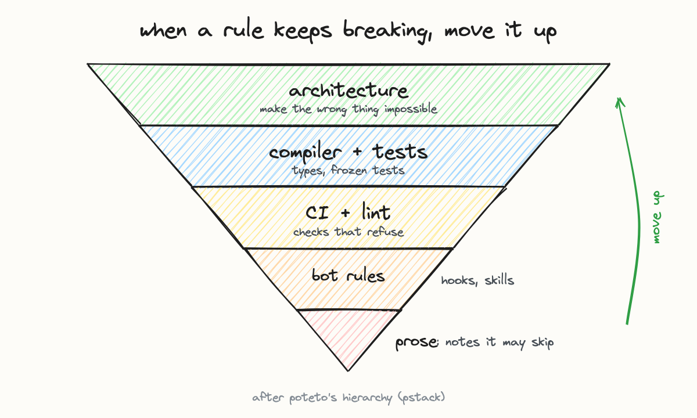

# Advanced: the full map

You run several agents, you have rules they keep breaking, and you've started writing checks
instead of more instructions. This is where the rest of the repo is for.

Start with these, in order:

1. [SKILL.md](../../SKILL.md), the entry point: which layer owns a problem, and how to route a task to it.
2. [The principles](../../rstack/principles/), each with the incident behind it and what enforces it.
   [Architecture, not prose](../../rstack/principles/architecture-not-prose.md) is the ladder above.
3. [STACK.md](../../rstack/STACK.md), the system rstack came from, with the failure behind each hook and job.
4. Build a map of your own setup with `rstack/coverage.py` (README, "Using it"). The point is the
   list of rules that are still only prose, ranked by how often they broke.
5. [The harness](../../harness/README.md), if you run agents on open research problems: lanes,
   frozen tests, independent scoring, and the yield check that stops a lane spending without finding anything.

There's no "next one" after this. You move up here by moving rules up the ladder.
