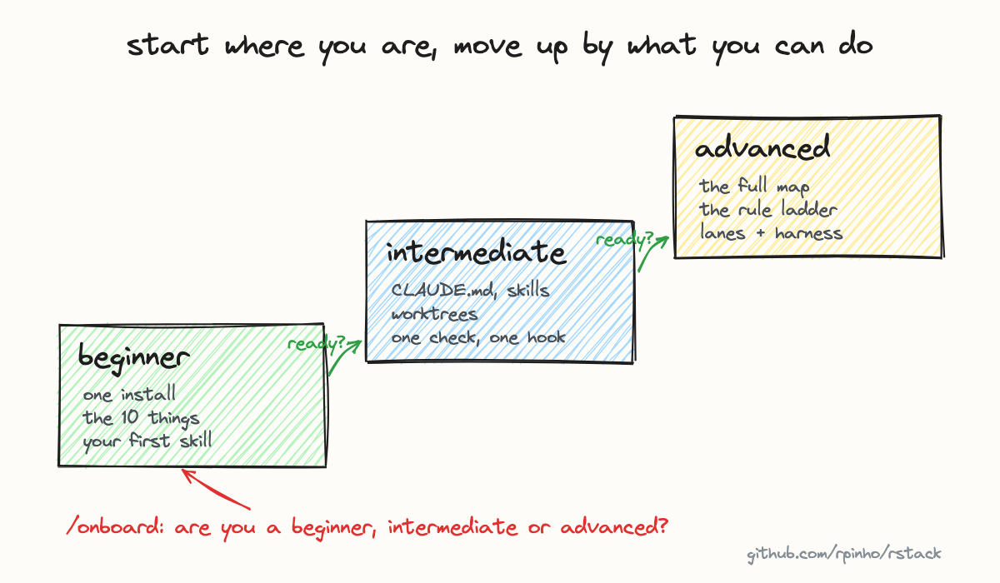

# Beginner: your first week with a coding agent

You don't need most of this repo yet. This page gets you from nothing to an agent that does useful
work for you, and one skill that makes it sound like you. It takes about an hour.



## 1. Install it

Install Claude Code with one command (macOS or Linux), then check it runs:

```sh
curl -fsSL https://claude.ai/install.sh | bash
claude --version
```

It needs a Claude account; the first run asks you to log in. If you use Codex instead, everything
below works the same way, with `AGENTS.md` where it says `CLAUDE.md`.

## 2. Give it a real task

Open a terminal in a folder you actually work in, and start it there:

```sh
cd ~/my-project
claude
```

Ask for something small and real: "read this folder and tell me what it does", or "this script
fails with this error, find out why". Watch what it does before you ask for more.

## 3. The ten things that matter

These cover most of what you'll use. Everything else can wait.

1. Start it in the folder you're working on. It reads what's there.
2. Say what you want and why. "Make this faster because the nightly run times out" beats "optimize".
3. Ask for a plan first on anything bigger than a small fix. Shift+Tab cycles the modes; one of them is plan mode.
4. Point at files with `@`, like `@analysis.py`, instead of describing them.
5. Esc stops it. Esc twice lets you go back to an earlier point in the conversation.
6. Read what it asks permission for before you say yes. That is where mistakes get caught.
7. Ask it to check its own work: run the tests, run the script, show you the output.
8. Use `/clear` when you switch to a different task, so the old one doesn't confuse the new one.
9. Commit with git before a big change, so you can always undo.
10. When you're stuck on the tool itself, ask it. It knows how it works, and `/help` lists the commands.

## 4. Your first skill: write like you

A skill is a folder with one file, `SKILL.md`, that teaches the agent how to do one thing your way.
A voice skill is a good first one, because it's useful on day one and you can tell right away if
it works.

Create `~/.claude/skills/my-voice/SKILL.md`:

```markdown
---
name: my-voice
description: Write emails and messages the way I write them. Use for any text I'll send as myself.
---

Write like me:
- Short sentences. Say the main thing first.
- No exclamation marks unless I'm really excited.
- No "I hope this finds you well" or other filler.

Three things I actually wrote:
- (paste a real message of yours)
- (another one)
- (another one)
```

Start a new session and ask: "use my-voice to answer this email: ...". If it doesn't sound like you,
edit the rules and try again. That loop is most of what working with skills is.

## Ready for the next one?

Move on to [intermediate](intermediate.md) when you can say yes to all three:

- I've used it on real work several times, not only tried it.
- I've asked for a plan first, and changed the plan before it ran.
- My voice skill gets used, and I've edited it at least once after seeing what it wrote.

If not yet, keep using it for a week. That's normal, and it's the part that matters.
