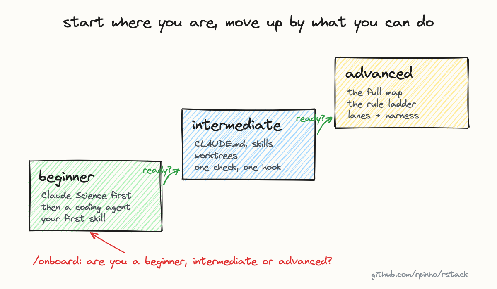

# Beginner: your first week with AI on your research

Start with a small task whose answer you can check. Build up to more work as you learn what the agent gets right and where you need to intervene.



## 1. Try Claude Science with one of your papers

In [Claude Science](https://support.claude.com/en/articles/16563838-get-started-with-claude-science), start a project with one of your papers and a question you never had time for. Try a check you always meant to run or an extension you sketched in the discussion. Read the result, ask for the code and check it.

The first step is the hardest. Move on when you've used the result to answer a real question.

## 2. Install a coding agent

For work in your own files, install Claude Code and check the version. Sign in when prompted. Use `CLAUDE.md` for project instructions in Claude Code or `AGENTS.md` in Codex.

```sh
curl -fsSL https://claude.ai/install.sh | bash
claude --version
cd ~/my-project
claude
```

## 3. Give it a real task

Try “this script fails with this error, find out why.” Point to a file with `@analysis.py`. Ask for a plan on a larger change (Shift+Tab cycles modes), read permission prompts, and ask the agent to run the script or tests and show the output.

Esc stops a turn. Esc twice opens rewind. Use `/clear` when changing tasks and `/help` to find commands. Commit before a big change so you have a known state to return to.

## 4. Your first skill: write like you

Create `~/.claude/skills/my-voice/SKILL.md` and replace the three placeholders with messages you wrote:

```markdown
---
name: my-voice
description: Write emails and messages the way I write them. Use for any text I'll send as myself.
---

Write like me:
- Short sentences. Say the main thing first.
- No exclamation marks unless I'm really excited.
- No "I hope this finds you well" or other filler.

Three things I actually wrote:
- (paste a real message of yours)
- (another one)
- (another one)
```

Start a new session and ask “use my-voice to answer this email.” Edit the skill after reading the draft.

## Ready for the next one?

Move on to [intermediate](intermediate.md) when you've used Claude Science or a coding agent on real research several times, changed the agent's plan before it ran, and revised a voice skill after seeing its output.
