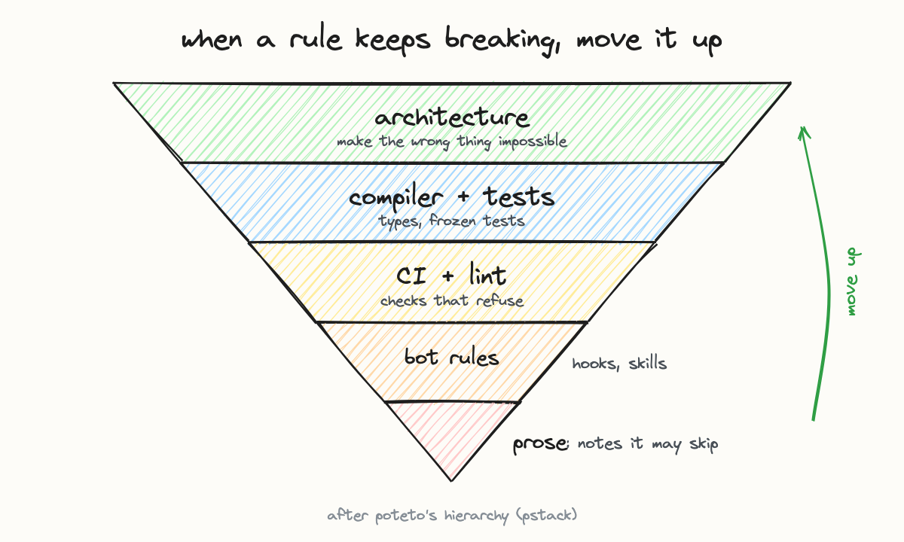

# Architecture, not prose

**The rule.** A rule that lives only in prose is worth whatever the agent that happened to read it
is worth. The same sentence as a hook, lint, script or test is worth the same on every run. So
when a rule gets broken repeatedly, the fix is a mechanism, not a firmer sentence.

The ladder is poteto's hierarchy: architecture makes the wrong thing impossible, the compiler and
tests catch it before it runs, CI and lint refuse it, bot rules (hooks, skills) steer the agent,
and prose is a note the agent may skip. A rule moves up a rung each time it breaks where it is.

**Enforced by** the coverage tool in this directory, which maps every rule to its enforcer or
marks it prose-only, and ranks the prose-only ones by how often they have actually been broken.

Read that ranking as a queue of candidates, not a backlog. On the setup it was built for, about
two thirds of the rules are still prose, and that is fine: see
[guards need a real failure](guards-need-a-real-failure.md).
